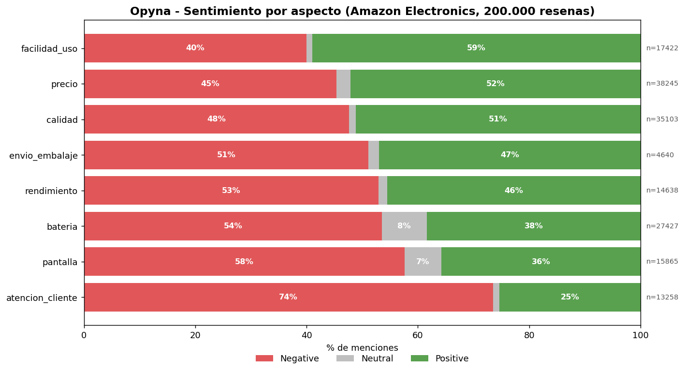

# Opyna: voice-of-customer intelligence from product reviews

Opyna turns free-text product reviews into business decisions: overall
sentiment, an estimated star rating, sentiment per product aspect (battery,
screen, price, customer service…), emerging problems, and prioritised
recommendations with a simple ROI model.

Master's thesis (TFM), Máster en Big Data, Data Science e Inteligencia
Artificial, Universidad Complutense de Madrid (NTIC), 2026.
Tutors: Carlos Ortega, Santiago Mota.

- **Live demo:** a Gradio app on Hugging Face Spaces (`rerc86/opyna`), protected
  with credentials.
- **Trained models:** `rerc86/opyna-sentimiento-200k` and
  `rerc86/opyna-rating-200k` on Hugging Face.
- **Data:** Amazon Reviews 2023
  (McAuley Lab), Electronics category, 200,000 reviews balanced by star rating
  (40,000 per rating, fixed seed). The dataset is not included; the pipeline
  downloads it from the source.

## Results

| Component | Metric | Value |
|---|---|---|
| Baseline: TF-IDF + logistic regression | F1-macro (3 classes) | 0.734 |
| Baseline: TF-IDF + LightGBM | F1-macro | 0.707 |
| Sentiment: fine-tuned DistilBERT | accuracy / F1-macro | 0.818 / 0.768 |
| Star rating 1–5: fine-tuned DistilBERT | exact / within ±1 star | 0.649 / 0.958 |
| Aspect-based sentiment (DeBERTa ABSA) | review × aspect pairs | 166,598 |
| ABSA check against an LLM annotator (n = 160) | agreement / F1-macro | 0.756 / 0.589 |
| Review helpfulness | ROC-AUC | 0.746 |

The ABSA check is indicative only: an LLM annotator is not human ground truth.



## Repository layout

| Path | Content |
|---|---|
| `notebooks/03_pipeline_completo.ipynb` | Full reproducible pipeline (13 phases, from EDA to ROI). Needs a GPU: about 40 min on an A100 |
| `notebooks/01_eda.ipynb`, `02_baseline.ipynb` | Early exploration and baseline |
| `src/opyna/` | Python package: data download and preprocessing, models, FastAPI service, web and bot entry points |
| `app/` | The deployed Gradio app (`app.py`) and its inference layer |
| `scripts/` | Recommendation layer (`opyna_recomendaciones.py`), ROI model (`opyna_roi.py`), API-guide generator (`opyna_guia_pdf.py`) |
| `results/` | Metrics, per-aspect table, emerging topics, recommendations, ROI scenarios |
| `figures/` | Charts produced by the pipeline |
| `docs/` | API integration guide (Spanish and English, PDF) |
| `tests/` | Unit tests for the API and preprocessing |

## Architecture

The project started from the classic pattern (FastAPI service, Docker,
`docker-compose`, Makefile, installable `src/` package with tests), which is kept
in this repository. The FastAPI `/analyze` endpoint in `src/opyna/api/` is the
early scaffold and returns placeholder labels. The model serving that was
actually deployed is the Gradio app in `app/`, running on CPU so that it can be
evaluated without GPU quotas. It exposes a structured JSON endpoint
(`predict_json`) for CRM, ERP or dashboard integration; see `docs/`.

A Telegram bot was planned but not implemented; only its entry point exists.

## Running

```bash
python -m venv .venv && source .venv/bin/activate
pip install -r requirements.txt && pip install -e .
pytest -q
uvicorn opyna.api.main:app --reload        # scaffold API on :8000
```

The app in `app/` reads its login from `OPYNA_AUTH_USER` and `OPYNA_AUTH_PASS`;
without them it runs without authentication. Pinned versions matter:
the pipeline needs `transformers<5`.

## What is not included

- The review texts (dataset, ABSA output parquet and the annotation gold set),
  which stay under the dataset's own licence. The pipeline regenerates them.
- The trained model weights (about 250 MB each), which are on Hugging Face.

## License

Code: MIT (see `LICENSE`). Amazon Reviews 2023 keeps its original licence from
McAuley Lab.
